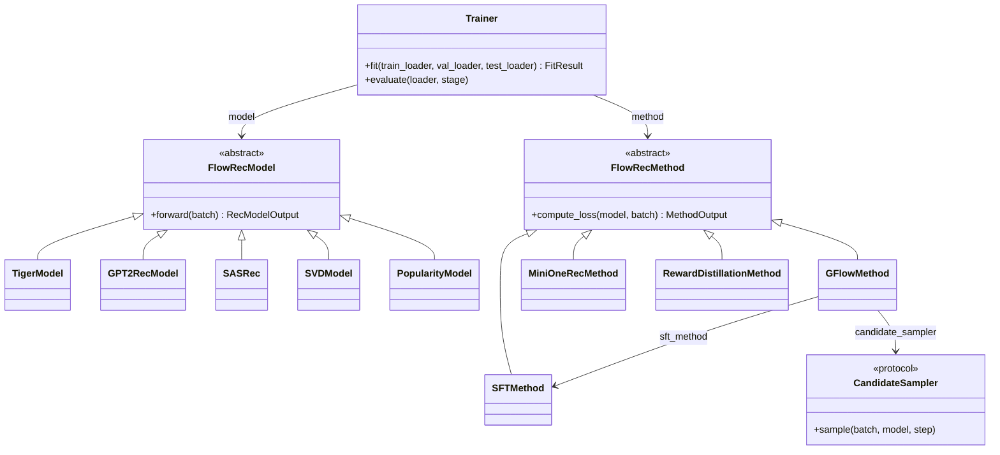

<p align="center">
  
</p>

# FlowRec

FlowRec is a research library for sequential recommendation. It provides
generative models that predict semantic item IDs, item-based recommendation
baselines, training objectives, reward functions, and a shared training loop.

## What is included

- **Models:** TIGER and GPT-2 recommenders over semantic IDs, SASRec, SVD and
  popularity baselines.
- **Objectives:** supervised fine-tuning (SFT), GFlowNet trajectory balance,
  detailed balance and subtrajectory balance, GRPO in the
  OneRec/MiniOneRec variant, and reward-distribution distillation.
- **Data:** Amazon Reviews and Yambda data modules, with
  leave-one-out splitting and configurable training layouts.
- **Item representations:** content embeddings and RQ-VAE tokenization for
  semantic IDs.
- **Rewards and sampling:** interaction, similarity, SASRec and SVD rewards,
  reward combinations, and semantic-ID candidate sampling.
- **Training and evaluation:** a reusable PyTorch trainer, checkpointing,
  logging, and ranking metrics such as Recall, NDCG and coverage.

Model capabilities differ: TIGER and GPT-2 generate semantic-ID sequences,
while item-based models operate on item IDs.

## Installation

Use Python 3.11 and install the pinned dependencies from the repository root:

```bash
python -m venv .venv
source .venv/bin/activate
python -m pip install -r requirements.txt
```

The repository has no package configuration; run commands from its root so
that Python can import `flowrec`. The dependency file also documents optional
packages for logging, data access, notebooks and individual pipelines.

To check the installation on CPU with synthetic data:

```bash
python scripts/smoke_test.py --device cpu
```

The smoke test exercises model training and generation and GFlowNet with a
synthetic reward cache. Run the test suite with:

```bash
python -m pytest
```

## Library API

Models provide prediction capabilities through `FlowRecModel`; each
`FlowRecMethod` defines an objective, and `Trainer` runs optimization and
evaluation. The available capabilities depend on the model.



The following example trains a small SASRec model on one synthetic batch and
evaluates that batch. It does not require downloading a dataset:

```python
import torch

from flowrec.ft_methods.sft import SFTMethod
from flowrec.models.sasrec import SASRec, SASRecConfig
from flowrec.training import Trainer, TrainerConfig

model = SASRec(SASRecConfig(
    item_vocab_size=16, max_history_len=4,
    d_model=8, nhead=2, num_layers=1, dropout=0, pos_drop=0,
))
batch = {
    "history_item_ids": torch.tensor([[0, 1, 2, 3], [0, 4, 5, 6]]),
    "history_mask": torch.tensor([[0, 1, 1, 1], [0, 1, 1, 1]], dtype=torch.bool),
    "target_item_ids": torch.tensor([4, 7]),
}
trainer = Trainer.from_optimizer_config(
    model=model,
    method=SFTMethod(),
    cfg=TrainerConfig(max_epochs=1, progress_bar=False),
    device="cpu",
)
trainer.fit([batch])
print(trainer.evaluate([batch], stage="test"))
```

The Amazon and Yambda data modules provide `setup()` and train,
validation and test data loaders. For GFlowNet, `GFlowMethod` takes an SFT
method, a candidate sampler and a configured precomputed reward cache; see
`GFlowConfig` and the experiment documentation for cache preparation.

For details, see the [configuration reference](docs/configuration.md) and
[rewards and candidate sampling](docs/rewards.md).

### GRPO (OneRec/MiniOneRec)

[`MiniOneRecMethod`](flowrec/ft_methods/mini_one_rec/method.py) implements
recommendation-oriented GRPO following the loss formulation in
[MiniOneRec](https://github.com/AkaliKong/MiniOneRec/blob/0cbd94de9ea58c59a6b05d4d1dbda7edf8d5b3b1/minionerec_trainer.py#L1041-L1070),
an open-source reproduction of OneRec. It generates groups of semantic-ID
candidates, normalizes reward advantages within each group, and optimizes a
token-level policy-gradient objective with a reference-policy KL penalty.
The `grpo_weight` and `sft_weight` settings control the GRPO and SFT terms.

The policy-gradient term uses `exp(logp - logp.detach())`, as in MiniOneRec.
This is the on-policy GRPO formulation; `clip_epsilon` is accepted in the
configuration but does not affect the loss. The runner selects this method
with `method.name: "mini-one-rec"`.

After preparing the dataset, semantic IDs and starting checkpoint referenced
by the [example configuration](configs/tiger_beauty_mini_one_rec_sample_rule_rank.json),
run:

```bash
python scripts/run_tiger.py \
  --config configs/tiger_beauty_mini_one_rec_sample_rule_rank.json
```

## Repository layout

| Path | Contents |
| --- | --- |
| [flowrec/data](flowrec/data) | Data modules, sequence splitting, datasets and collators |
| [flowrec/item_representation](flowrec/item_representation) | Content embeddings and semantic-ID tokenizers |
| [flowrec/models](flowrec/models) | Recommendation model interfaces and implementations |
| [flowrec/ft_methods](flowrec/ft_methods) | Training objectives and loss calibration |
| [flowrec/rewards](flowrec/rewards), [candidates](flowrec/candidates), [trajectories](flowrec/trajectories) | Rewards, candidate sampling and trajectory operations |
| [flowrec/training](flowrec/training), [evaluation](flowrec/evaluation), [inference](flowrec/inference) | Training loop, metrics and generation |
| [docs](docs) | Library configuration and reward reference |
| [configs](configs), [scripts](scripts) | Configurations and experiment entry points |
| [examples](examples), [tests](tests) | Notebooks and automated checks |

For experiment protocols and commands, see
[exp1](scripts/exp1-standard-params/README.md),
[exp2](scripts/exp2-tuned-params/README.md),
[exp4](scripts/exp4-reward-ablations/README.md),
[exp5](scripts/exp5_result_analysis/README.md),
[exp6](scripts/exp6-ce-distillation/README.md),
and [exp7](scripts/exp7-from-sft/README.md).
Historical result, cache, and checkpoint paths keep their original names.
The selected model weights and their layout are described in
[checkpoints/README.md](checkpoints/README.md).

## Reported metrics

The [three-dataset results snapshot](results/icde2027/README.md) includes
Beauty, Musical Instruments, and Yambda 50M, with best NDCG@10, best Coverage@10,
and Pareto selections. Download the [Excel workbook](results/icde2027/metrics.xlsx)
or use the [selected-results CSV](results/icde2027/selected_metrics.csv).
The snapshot documents test-based selection, confidence intervals, starting
checkpoints, and the distinction between reported summaries and per-run candidates.
It includes GRPO results from both starting stages and CE reports from initial
and SFT-only models, with scientific parameters and source provenance.
